# It’s SFT all the way down: learning Kaggriculture one action at a time

*5th place (gold) in [Kaggriculture](https://www.kaggle.com/competitions/kaggriculture), team 有辣条有权.*

| Looking for | Go to |
|---|---|
| What we did, technique by technique, with links to the code | [HOW-IT-WORKS.md](HOW-IT-WORKS.md) |
| Every feature, and the solvers that compute them | [FEATURES.md](FEATURES.md) |
| The code that matters, flat and grouped: features, Model 1, Model 2 | [code/](code/) (Model 1 [`model.py`](code/model1/model.py), Model 2 [`nf_model.py`](code/model2/nf_model.py)) |
| Training on one replay, end to end | [quickstart/](quickstart/) |
| How games were collected, filtered and sampled | [data/](data/) |
| The submitted agents, and how candidates were compared | [submissions/](submissions/) · [evaluation/](evaluation/) |
| Rebuilding both submissions from scratch | [REPRODUCE.md](REPRODUCE.md) |

[Intro](#intro) · [Resources](#resources) · [Models](#models) · [Features](#features) · [Data](#data) · [Biggest lesson](#biggest-lesson) · [Code](#code)

## Intro

This covers my attempt at using SFT to solve Kaggriculture. It assumes the vocabulary in the [competition overview](https://www.kaggle.com/competitions/kaggriculture/overview).

I don't quote leaderboard scores. The Elo-style rating only means something relative to the field at the time: a bot of the same strength would score several hundred points lower later on, because the field as a whole got stronger as time went on, and the rate of improvement increased closer to the deadline, especially once a lot of people moved to using all four quadrants in the last three days.

I mostly document what worked. Plenty didn't, and I don't keep meticulous logs of what failed. Each failure still cost real time. For example, I spent two weeks factoring the game's micro decisions into macro decisions, down to a page of theorems on how to handle them (311 claims, 919 linked pairs). This is the approach I really wanted to take, but it proved too much for agents to keep track of at once, even after I simplified it for them. They still made very subtle mistakes. I imagine this method will work once agents get stronger.

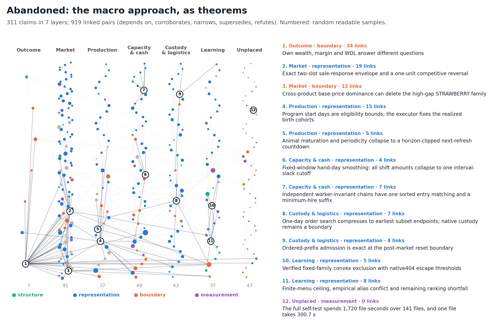

## Resources

I enter each competition to win or learn as much as possible, within a budget. Here: two 4090s I own, a 3090 (that kept dying), a DGX Spark and a laptop 4060 for eval games, Colab G4s rented on 29 and 30 Sep, and Kaggle CPU notebooks for evals. I have two Claude and two GPT subscriptions. These resources are shared among all my projects, including personal ones.

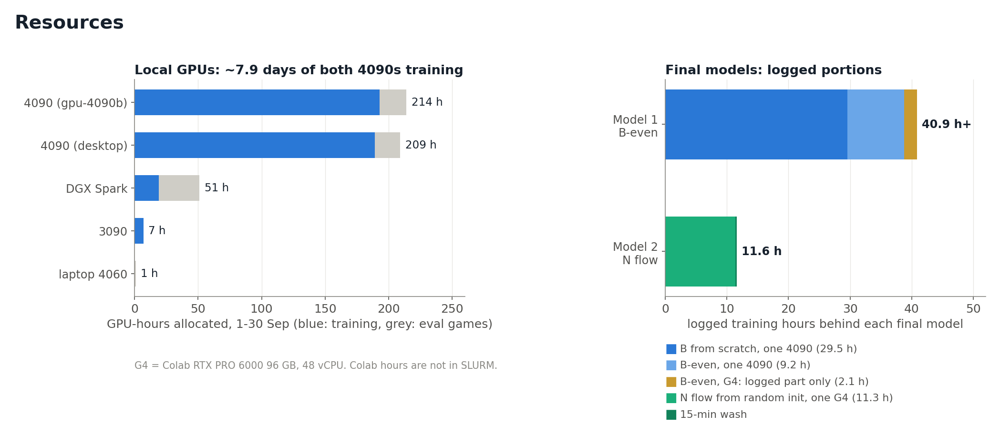

If I had more compute, I would have used it.

Team name: **有辣条有权** ("you la tiao you quan"). La tiao is a famous cheap spicy snack, and the name is a play on **有钱有权** ("you qian you quan"): "To have money is to have power." Swap 钱 (qian, money) for 辣条 (la tiao) and you get the team name.

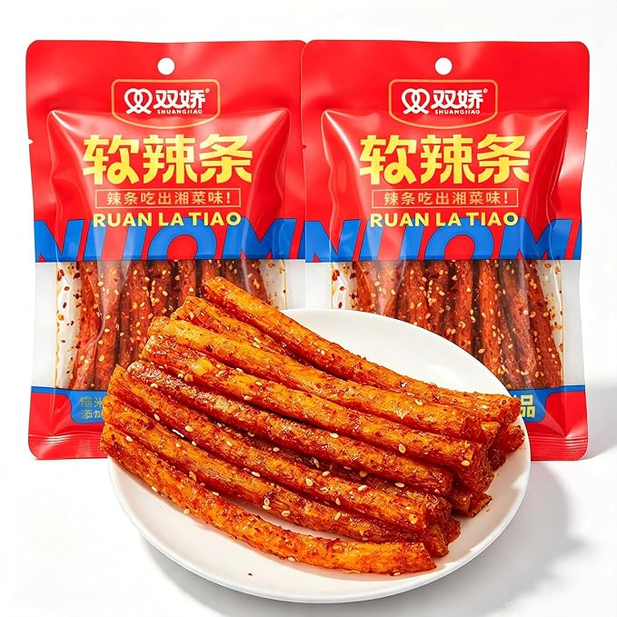
## Models

These were my two final submissions. The larger, longer-trained B-even model finished ahead of N-flow and set the team's placing.

### Abandoned

The macro approach went first, so I won't discuss the architectures I considered there. Everything below came after I switched to micro decisions generated autoregressively. I had [this lecture series](https://www.youtube.com/watch?v=SQ3fZ1sAqXI&list=PLoROMvodv4rOY23Y0BoGoBGgQ1zmU_MT_) playing in the background, and it drove the switch. This game doesn't seem that different from writing a paragraph in a very specific style.

I train on the state the winner saw and the actions they sent. During play, the model generates worker commands, then orders, then STOP, one token at a time, with each token seeing the earlier choices from that turn.

Other failures:

1. **Chain of thought:** force an unsupervised label onto every tile before deciding.
2. **Recurrence in depth:** rerun the middle blocks several times. Showed a lot of promise early, with some of our best losses, but needed too many ablations to get right. No time to tune how many times, or which layers, to recur, and it ended up doing poorly late with the config I chose. Something I'll try earlier next time.
3. **Depth over width:** worse loss immediately.
4. **Massive parallel heads:** 36 heads of width 12. Did very well and only started to do poorly later, which leads to Model 1.

### Model 1: B-even

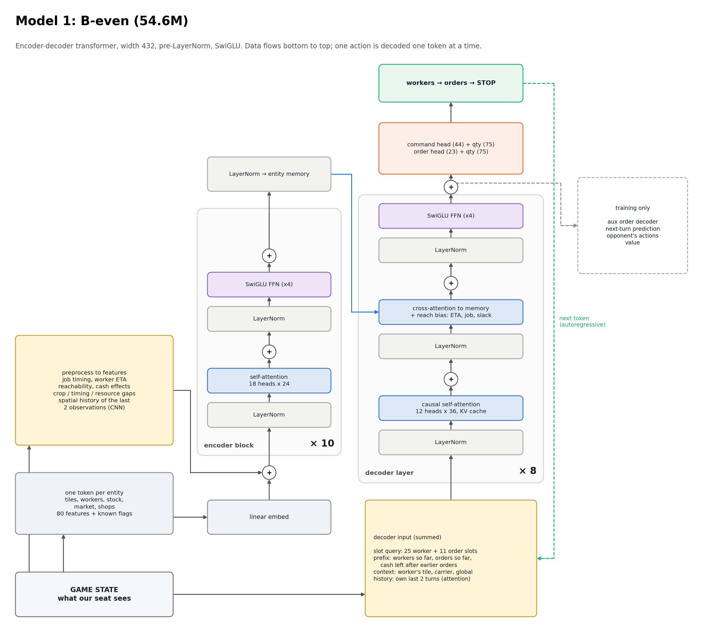

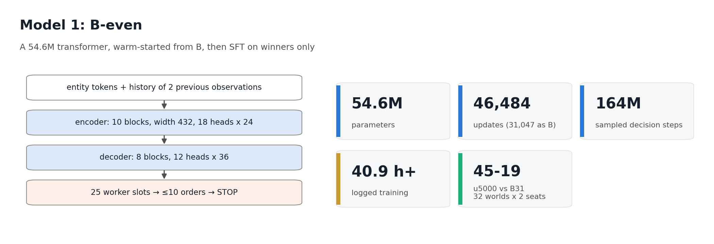

The 36-head model with its heads regrouped to 18 × 24. Shipped with a 4-update sprinkle on the five newest #1-team wins.

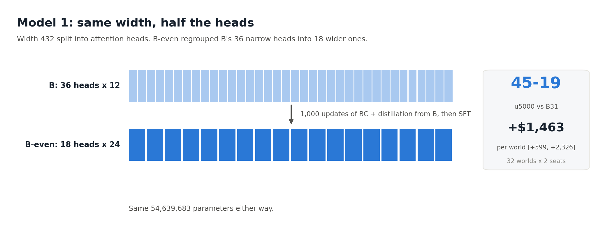

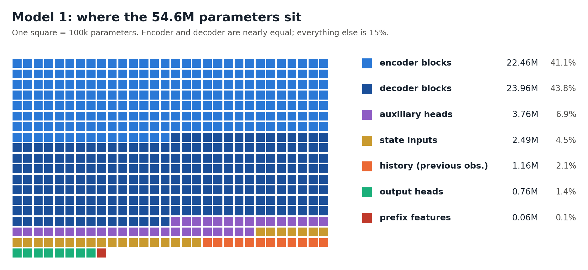

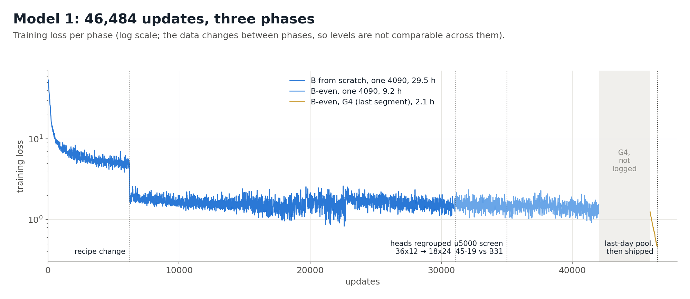

### Model 2: N flow

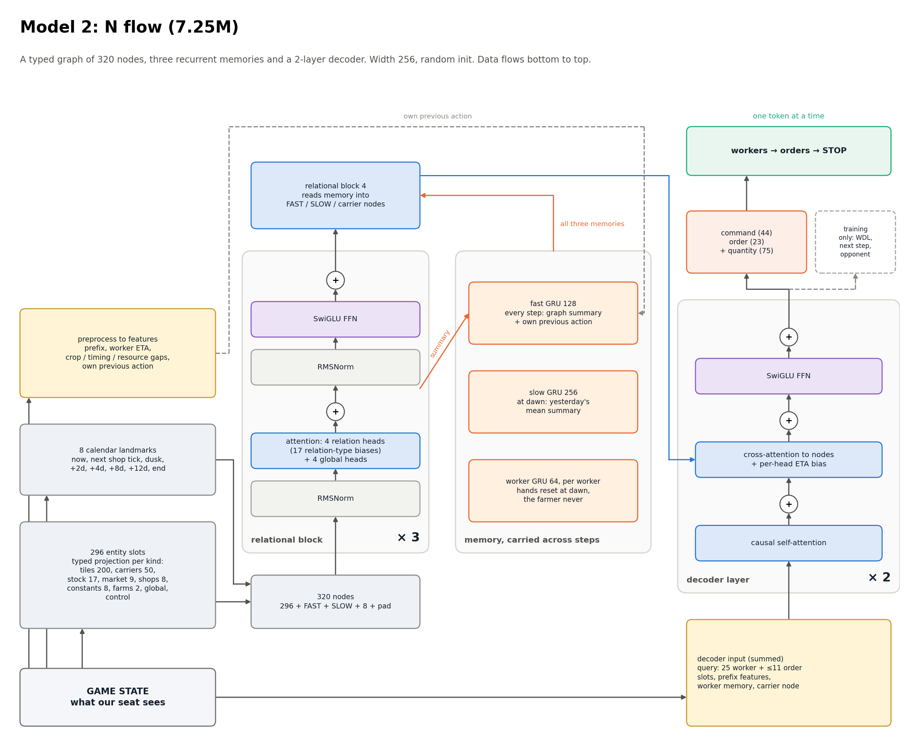

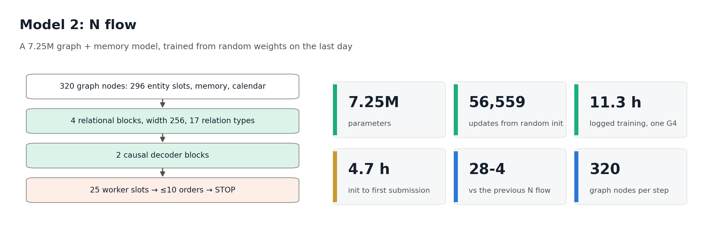

Random init on one G4. Shipped with a 15-min wash: low-learning-rate SFT on top-3 wins.

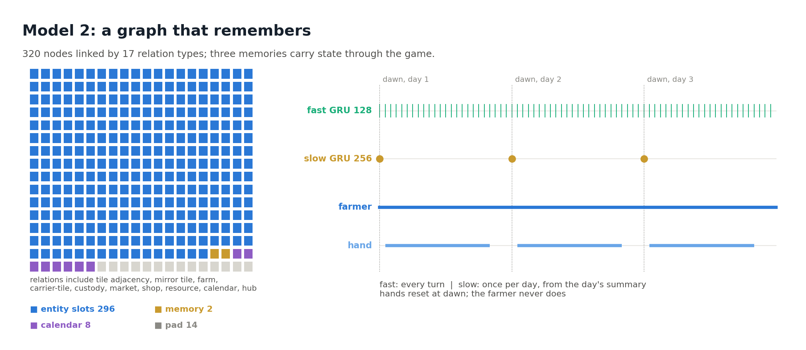

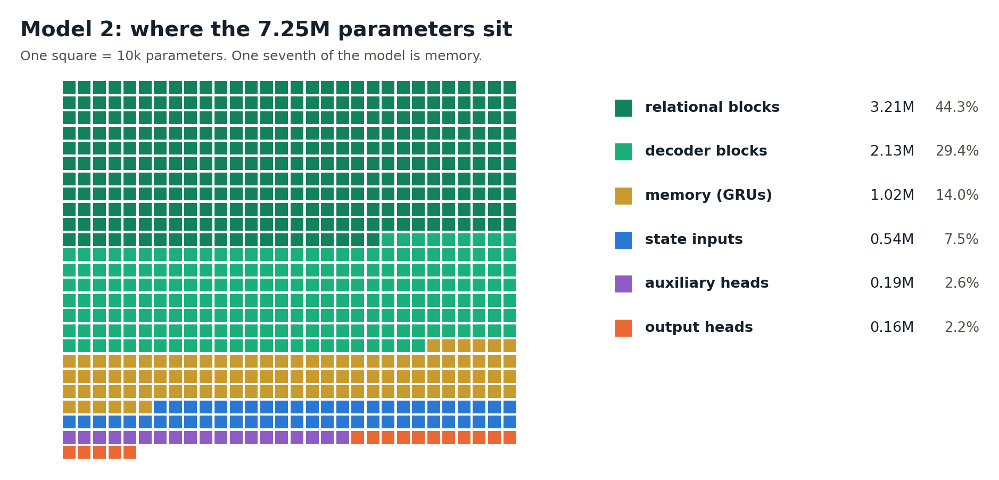

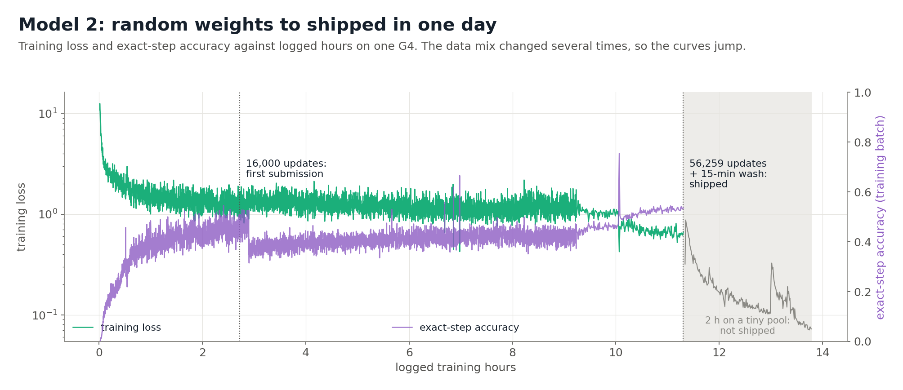

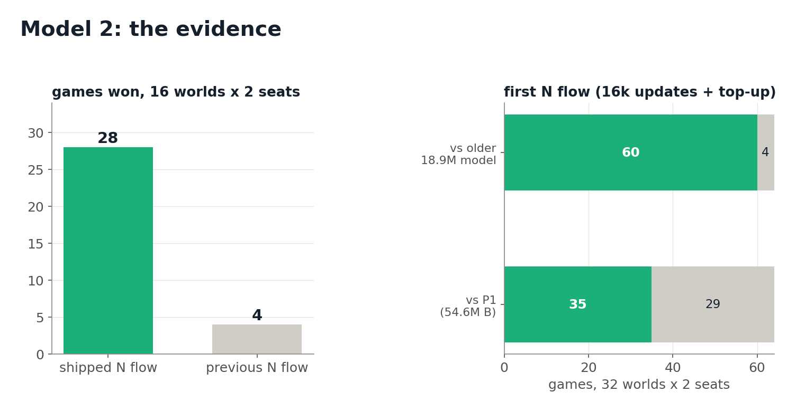

## Features

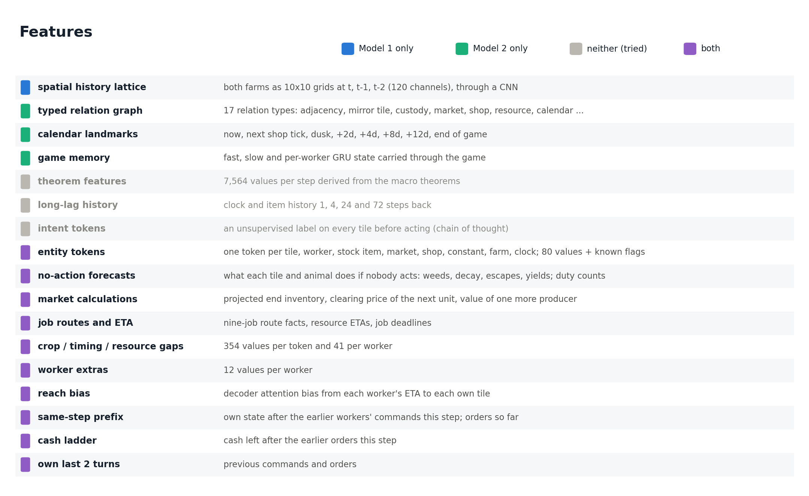

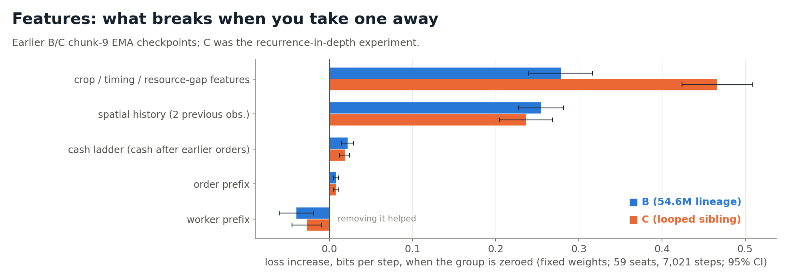

## Data

How the SFT data was filtered and changed:

- **Winners only.** Never imitate a losing action. In games we lost, train on the player who beat us.
- **Weighted to fresh and strong.** Hourly buckets by day and rank; the newest and strongest games get most of the draws.
- **Earlier, our own ladder games too.** Whatever beat our policy became training data.
- **Last day: top 3 only.** 30 Sep wins by the top three teams (404 source seats); the seats that beat #1 count 4x.
- **Short top-ups.** 15 minutes at low LR on the newest winners, exporting the current, unaveraged weights (RAW).
- **Held out.** Validation and sealed games were excluded early. Some validation games entered the late pool.

We could only find 3 wins against the first-place solution at the time we trained, and two of them were from its own validation games!

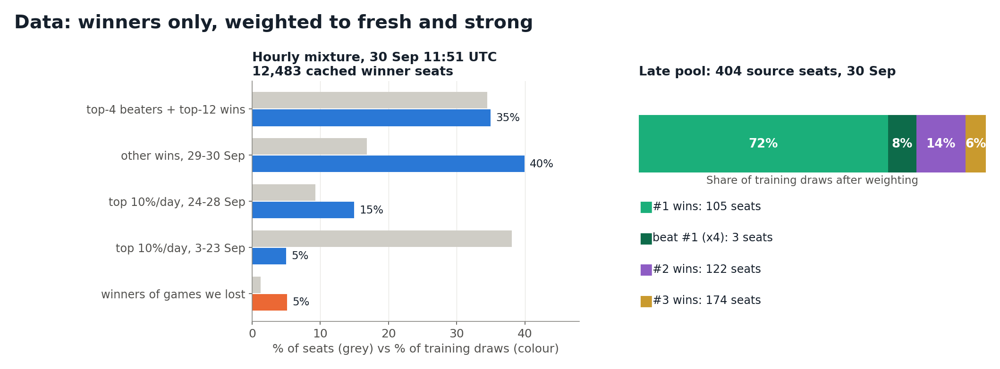

Replays came from Kaggle's daily episode dumps. The replay API was only for our own losses, and on the last two days for everything, at ~150-170 an hour. I also tried pulling replays by hand on the website: similar rate, but the API was less boring :D

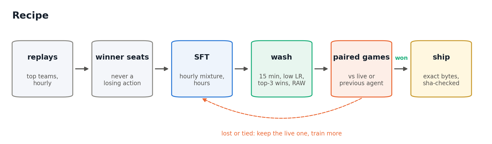

## Biggest lesson

What I think was most useful was the workflow I refined during this competition, and will keep refining going forward.

Keep 2-3 ideas alive. Each has a fallback, a current best and a current experiment. Go crazy with the experiment until it beats the best, then try a new crazy experiment. Once you've experimented enough, the best becomes the new fallback. An experiment can itself be a set of ideas, so it's basically tree search over ideas.

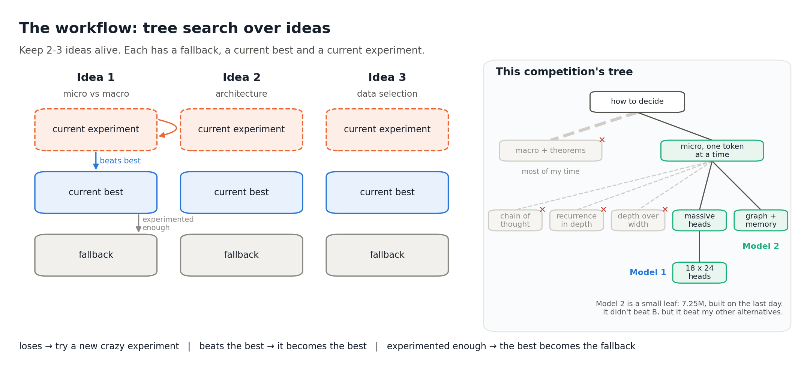

Finally, we used a special version of the engine for matched games, so that shop rolls depend only on the initial seed.

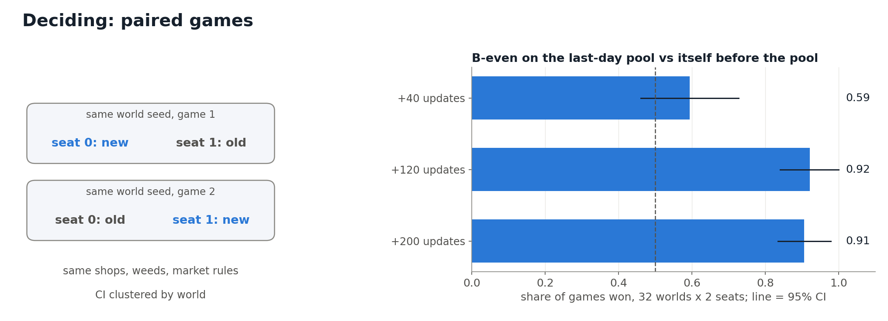

## Code

Everything needed to rebuild both final submissions from the Kaggle episodes is in this repo. The episodes themselves are not included; they come from Kaggle. See [REPRODUCE.md](REPRODUCE.md). To jump from an idea in this write-up to the code that implements it, use [HOW-IT-WORKS.md](HOW-IT-WORKS.md).

| Folder | What |
|---|---|
| [`code/`](code/) | start here to read: byte-identical copies of the ~50 files that matter, flat and grouped |
| [`quickstart/`](quickstart/) | start here to run: one replay → features → a few training updates for each model |
| [`submissions/`](submissions/) | the two final archives exactly as submitted, plus their unpacked inference code |
| [`data/`](data/) | episode download, replay processing, winner-seat selection, buckets and rosters |
| [`model1-b-even/`](model1-b-even/) | Model 1 training code and every stage from random init to the shipped checkpoint |
| [`model2-n-flow/`](model2-n-flow/) | Model 2 training code and every stage from random init to the shipped checkpoint |
| [`evaluation/`](evaluation/) | paired-game comparison on shared worlds, including the shop-fixed version, and the records behind both release decisions |
| [`figures/`](figures/) | scripts and data behind the figures in this write-up |
| [`tools/`](tools/) | `list_features.py`, which generates [FEATURES.md](FEATURES.md) from the code |
